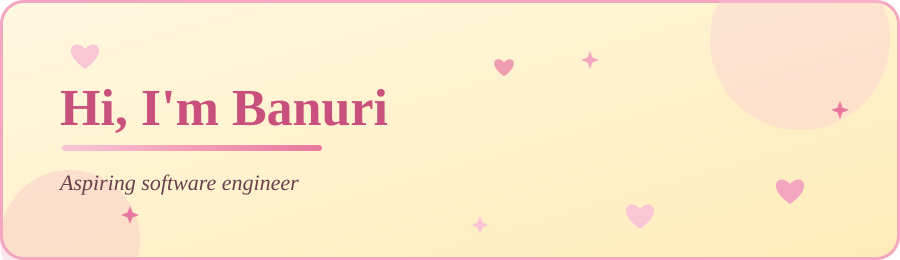
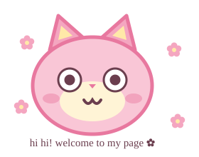

  

 

## ✿ Pick a flower

🌷 <b>Tulip</b>

> Today is going to be a good one ☀️

🌼 <b>Daisy</b>

> Small steps still count 🐾

🌸 <b>Blossom</b>

> Thanks for stopping by, have a lovely day! 🎀

 

## ✿ About me

Software engineering student who enjoys building practical apps, from mobile apps to management systems. Currently looking for a **software engineering internship** where I can learn from a team and ship real features.

 

## ✿ Skills

  
  
  
  
  
  

 

## ✿ Projects (tap to open)

<b>📱 Tracky Mobile Application</b> · Java

 

[One or two lines on what it does and what you built.](https://github.com/movb0/TrackyMobileApplication)

<b>🏥 Suwapiyasa Hospital Management System</b>

 

[One or two lines on what it does and what you built.](https://github.com/movb0/SuwapiyasaHospitalManagementSystem)

<b>🚕 Cab Service Management System</b> · Python

 

[One or two lines on what it does and what you built.](https://github.com/movb0/CabServiceManagementSystemm)

<b>🎀 Front-End Dev Project</b> · HTML / CSS

 

[One or two lines on what it does and what you built.](https://github.com/movb0/Front-end-Dev-Project1)

 

## ✿ GitHub stats

  
  

  

 

## ✿ Get in touch

  
  

<!--
**movb0/movb0** is a ✨ _special_ ✨ repository because its `README.md` (this file) appears on your GitHub profile.

Here are some ideas to get you started:

- 🔭 I’m currently working on ...
- 🌱 I’m currently learning ...
- 👯 I’m looking to collaborate on ...
- 🤔 I’m looking for help with ...
- 💬 Ask me about ...
- 📫 How to reach me: ...
- 😄 Pronouns: ...
- ⚡ Fun fact: ...
-->
